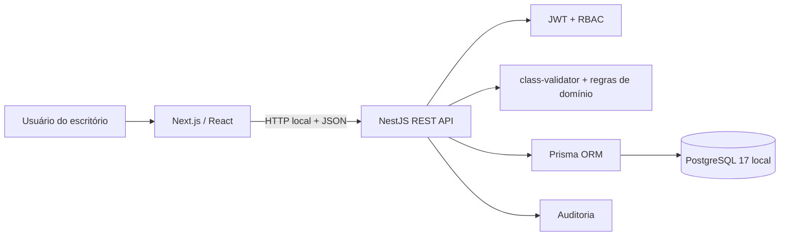

# Arquitetura do JurisFlow

## Visão geral

## Frontend

O frontend fica em `app/` e usa Next.js com App Router. `app/page.tsx` controla login, validação da sessão local e logout. `app/crm-app.tsx` implementa navegação, formulários, busca, CRUD, pipeline de oportunidades, kanban, importação CSV e auditoria.

O token JWT é mantido no armazenamento local do navegador durante o MVP. Todas as chamadas enviam `Authorization: Bearer <token>` para a API em `http://localhost:3001/api`.

## Backend

O backend fica em `backend/src/` e é uma aplicação NestJS independente. A API usa:

- controllers para expor rotas REST;
- DTOs e `class-validator` para validar entradas;
- guards JWT e de papéis para autorização;
- Prisma Service para acesso ao PostgreSQL;
- serviço de CRM para regras de negócio e auditoria;
- middleware para registrar método, rota, status e duração.

Principais rotas:

- `POST /api/auth/login` e `GET /api/auth/me`;
- `GET /api/crm`;
- `POST|PUT|DELETE /api/clients`;
- `POST|PUT|PATCH|DELETE /api/opportunities`;
- `POST|PUT|DELETE /api/matters`;
- `POST|PUT|PATCH|DELETE /api/tasks`;
- `POST /api/imports/clients/preview` e `POST /api/imports/clients`;
- `GET /api/audit`;
- `GET /api/health`.

## Banco e migrations

O modelo Prisma está em `prisma/schema.prisma`. As migrations estão versionadas em `prisma/migrations`. O iniciador usa PostgreSQL 17 incorporado, persistente, em UTF-8 e restrito ao computador, na porta 5433.

## Papéis de acesso

- `ADMIN`: acesso completo, auditoria e operações destrutivas.
- `LAWYER`: gestão dos registros jurídicos, importação e exclusões.
- `ASSISTANT`: consulta, criação e edição, sem exclusões administrativas nem auditoria.

## Correspondência com o plano

| Plano de estágio | Implementação |
|---|---|
| Modelagem lógica e dicionário | Prisma schema, relacionamentos, índices e dicionário |
| PostgreSQL e migrations | PostgreSQL 17 local e migration versionada |
| Seeds e dados sintéticos | Três usuários e demonstração jurídica sintética |
| Qualidade de dados | DTOs, e-mail, datas, CPF/CNPJ, CNJ e duplicidades |
| API NestJS + Prisma | Backend separado e rotas REST |
| Autenticação e RBAC | JWT, bcrypt e papéis ADMIN/LAWYER/ASSISTANT |
| Oportunidades e pipeline | CRUD, vínculo com cliente e movimentação entre etapas |
| Importação CSV/UI | Separadores vírgula/ponto e vírgula, UTF-8, pré-validação, confirmação, carga parcial de clientes/oportunidades e histórico |
| Mini UI Next.js/TS | CRUD, busca, formulários e estados de interface |
| Testes, linters e CI | Jest, integração, ESLint, build e workflow PostgreSQL |
| Performance e índices | Índices, paginação e limites de consulta/importação |
| LGPD, segurança e backups | Controle de acesso, auditoria, Helmet e exportação local |
| Observabilidade e logs | Log HTTP com duração e trilha de negócio |
| UAT, documentação e runbooks | Documentação operacional e critérios verificáveis |
| Hardening | Validação estrita, guards, senhas hash e headers seguros |
